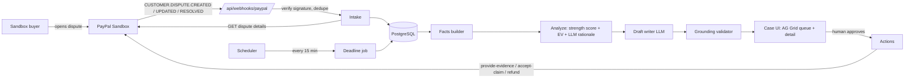

# 02 - Architecture: DisputeDefender

Audience: AI coding agents and developers. Read together with `AGENTS.md`.

## 1. System overview



Principle: **LLM for language, code for decisions.** The model summarizes and writes. Scores, costs, state transitions, and every PayPal write are plain code behind a human approval.

## 2. Stack and rationale

| Layer | Choice | Why |
|---|---|---|
| App | Next.js App Router, TypeScript strict | One repo for UI + API, easy deploy, great for vibecoding |
| UI | Tailwind + shadcn/ui, AG Grid (React) | Fast polished UI; AG Grid is a sponsor and fits the queue use case |
| DB | PostgreSQL (`pg`) + Drizzle | One `docker compose up -d` locally. Tables are created and demo data is seeded on boot |
| LLM | Vercel AI SDK, structured output with zod | Provider-agnostic. Switch model by env without code changes |
| PayPal | Thin fetch client + `@paypal/agent-toolkit` for read tools | Evidence upload needs raw multipart REST. Toolkit shows genuine agent integration |
| PDF | `pdf-lib` | Pure JS, no headless browser needed |
| Tests | Vitest + recorded fixtures | Fast, no network |

Check the installed version's docs for exact API names of the AI SDK and the toolkit before using them. Do not rely on memory.

## 3. Environment variables

```
PAYPAL_ENV=sandbox
PAYPAL_CLIENT_ID=
PAYPAL_CLIENT_SECRET=
PAYPAL_WEBHOOK_ID=            # from the webhook registered in the developer dashboard
PAYPAL_BUYER_PAYER_ID=        # sandbox buyer used by the "simulate dispute" helper
AI_PROVIDER=                  # anthropic | google | openai
AI_MODEL=
AI_API_KEY=
DATABASE_URL=file:./data/app.db
APP_BASE_URL=http://localhost:3000
APP_PASSWORD=                 # optional basic-auth for hosted demo
CRON_SECRET=
DEMO_MODE=true                # reseed on boot if DB is empty
DISPUTE_FEE=0.00              # configurable, verify PayPal fee schedule
EFFORT_COST=5.00              # merchant time cost per contested case (USD)
AUTOPILOT=false
```

## 4. Data model (Drizzle, PostgreSQL)

Money columns store integer minor units plus `currency`. Timestamps are ISO strings in UTC.

| Table | Key columns |
|---|---|
| `orders` | `id`, `paypal_order_id`, `capture_id`, `buyer_email`, `buyer_name`, `ship_to_json`, `items_json`, `amount_minor`, `currency`, `status` (created, paid, shipped, delivered), `carrier`, `tracking_number`, `shipped_at`, `delivered_at` |
| `policies` | `id`, `kind` (shipping, return, tos), `title`, `body_md`, `version` |
| `comms` | `id`, `order_id`, `direction` (buyer, merchant), `body`, `sent_at` (seeded or real) |
| `disputes` | `paypal_dispute_id` (PK), `capture_id`, `order_id` (nullable fk), `reason`, `paypal_status`, `life_cycle_stage`, `amount_minor`, `currency`, `seller_response_due_at`, `case_state`, `raw_json`, `created_at`, `updated_at` |
| `facts` | `id` (stable like `F-ord-001`), `dispute_id`, `kind` (order, payment, tracking, delivery, policy, comms, dispute_msg), `label`, `value`, `source` (table and id), `untrusted` (bool) |
| `analyses` | `id`, `dispute_id`, `strength_score`, `strength_breakdown_json`, `p_win_band`, `fight_loss_minor`, `refund_loss_minor`, `recommendation`, `rationale`, `model`, `created_at` |
| `drafts` | `id`, `dispute_id`, `version`, `evidence_type`, `body_json` (paragraphs with `claimRefs`), `notes_text`, `pdf_path`, `grounding_status` (pass, fail, edited_pass), `grounding_errors_json`, `status` (draft, approved, submitted), `author` (model id, template, merchant_edit) |
| `actions` | `id`, `dispute_id`, `type` (provide_evidence, accept_claim, refund), `payload_json`, `paypal_response_json`, `status`, `approved_by`, `created_at` |
| `audit_log` | `id`, `ts`, `actor` (agent, human, system, paypal), `dispute_id`, `action`, `detail_json` |
| `webhook_events` | `event_id` (PK), `event_type`, `payload_json`, `received_at`, `processed_at` |

`case_state` values: `NEW -> ANALYZED -> DRAFTED -> APPROVED -> SUBMITTED -> RESOLVED`, plus `ACCEPTED`, `REFUNDED`, `EXPIRED`, `NEEDS_ATTENTION`. Only the transitions in `src/lib/agent/state.ts` are allowed.

## 5. PayPal integration

Base URL: `https://api-m.sandbox.paypal.com`.

**Auth.** `POST /v1/oauth2/token` with HTTP Basic (client id and secret) and `grant_type=client_credentials`. Cache the token until shortly before expiry.

**Endpoints we use** (confirmed in PayPal's Disputes API reference):

| Purpose | Method and path |
|---|---|
| List disputes (poll fallback) | `GET /v1/customer/disputes` |
| Dispute details | `GET /v1/customer/disputes/{id}` |
| Provide evidence | `POST /v1/customer/disputes/{id}/provide-evidence` |
| Accept claim | `POST /v1/customer/disputes/{id}/accept-claim` |
| Make offer (stretch) | `POST /v1/customer/disputes/{id}/make-offer` |
| Sandbox: create dispute (as buyer) | `POST /v1/customer/disputes` (needs `PayPal-Auth-Assertion`) |
| Sandbox: settle in a party's favor | `POST /v1/customer/disputes/{id}/adjudicate` |
| Sandbox: change status | `POST /v1/customer/disputes/{id}/require-evidence` |
| Verify webhook signature | `POST /v1/notifications/verify-webhook-signature` |
| Refund a capture | `POST /v2/payments/captures/{capture_id}/refund` |
| Orders | `POST /v2/checkout/orders`, `POST /v2/checkout/orders/{id}/capture` |

Add shipment tracking through PayPal's tracking API (or the toolkit's `create_shipment_tracking` tool). Confirm the exact endpoint in the docs during T08.

**Rules that matter:**
- The merchant can provide evidence only while the dispute status is `WAITING_FOR_SELLER_RESPONSE`.
- In the live environment merchants cannot create disputes. In the sandbox they can, and the app must have Disputes enabled in its feature options.
- Sandbox negative-path test values exist (for example `/v1/customer/disputes/ERRDIS015` returns `FORBIDDEN`). Use them in error-handling tests.

**Evidence request format** (multipart form):
- field `input`: JSON string, for example
  `{"evidences":[{"evidence_type":"PROOF_OF_FULFILLMENT","evidence_info":{"tracking_info":[{"carrier_name":"FEDEX","tracking_number":"122533485"}]},"notes":"..."}]}`
- file field(s) for documents (the reference example uses `evidence-file`). Supported types JPG, GIF, PNG, PDF. Reported limit is about 50 MB per case. Confirm field name and limits against a real sandbox call in T04.

**Reason to evidence mapping** (from PayPal's dispute reasons doc):

| Reason | Evidence type | What PayPal needs |
|---|---|---|
| `MERCHANDISE_OR_SERVICE_NOT_RECEIVED` | `PROOF_OF_FULFILLMENT` | Carrier name and tracking number, or notes or documents (for example proof of delivery) |
| same | `PROOF_OF_REFUND` | Refund ID(s) in `evidence_info.refund_ids` |
| `MERCHANDISE_OR_SERVICE_NOT_AS_DESCRIBED` | `OTHER` | Notes or documents, such as product description, item URL, return policy, contract |

**Webhooks.** Events: `CUSTOMER.DISPUTE.CREATED`, `CUSTOMER.DISPUTE.UPDATED`, `CUSTOMER.DISPUTE.RESOLVED`. Signature headers: `PAYPAL-TRANSMISSION-ID`, `PAYPAL-TRANSMISSION-TIME`, `PAYPAL-TRANSMISSION-SIG`, `PAYPAL-CERT-URL`, `PAYPAL-AUTH-ALGO`. Verify by posting these plus the raw body and your `webhook_id` to the verify endpoint. Return 200 quickly, then process. The developer dashboard has a webhook simulator for mock events.

**PayPal-Auth-Assertion.** Needed to create a dispute as a buyer in the sandbox. It is an unsigned JWT identifying the acting account. Read the "Test and go live" disputes doc for the exact payload before implementing, and record a working request as a fixture. If it does not work by the end of T04, use the fallback: open the dispute manually from the sandbox buyer account's Resolution Center. The rest of the pipeline is unaffected.

**Field names.** Dispute objects include fields such as `dispute_id`, `reason`, `status`, `dispute_state`, `dispute_life_cycle_stage`, `disputed_transactions`, `dispute_amount`, `seller_response_due_date`, `messages`, `evidences`. Confirm each against a recorded response before relying on it.

## 6. Agent pipeline

All steps log to `audit_log`. Steps 1, 2, 4 are deterministic code. Steps 3 and 5 call the LLM with no tools. `src/lib/agent/pipeline.ts` (`processDispute`) runs steps 2 to 5 for one dispute; it only acts on cases in `NEW`, `ANALYZED`, `DRAFTED`, or `NEEDS_ATTENTION`, so an approved or submitted case is never rewritten. The webhook, the sandbox simulator, and the demo seed all use it.

1. **Intake** (`app/api/webhooks/paypal/route.ts`, `lib/paypal/sync.ts`): webhook -> verify -> dedupe -> GET details -> upsert `disputes` -> link `order_id` by custom id or capture id -> rebuild facts -> start the pipeline in the background for a new case, so PayPal gets its 200 quickly.
2. **Facts** (`facts.ts`): build `facts` rows with stable IDs (`F-<kind>-<disputeId>[-n]`) from the dispute, order, payment, ship-to address, tracking, delivery date, shipping and return policies, store messages, and messages on the PayPal dispute. Dates are ISO (`YYYY-MM-DD`) so the validator can compare them. Buyer-authored text is `untrusted=1`. The same records give the evidence signals used by the score, so a signal only counts when a citable fact exists; buyer messages never satisfy the communication-log signal.
3. **Analyze** (`analyze.ts`):
   - Deterministic **strength score** per reason (see below).
   - Deterministic **cost comparison** (see below).
   - The LLM writes a short rationale from the checklist and fact labels. It cannot change numbers or the recommendation, and a rationale containing any digit is discarded in favor of the rule-based one. `analyses.model` records who wrote it (`rules` or the model id).
4. **Decision** (`decision.ts`): recommendation is a pure function of score, amount, fee, effort cost, and evidence validity.
5. **Draft** (`draft.ts`): LLM returns structured output (zod):
   ```
   Draft = {
     summary: string,
     sections: [{ heading: string, paragraphs: [{ text: string, claimRefs: string[] }] }]
   }
   ```
   Prompt rules: use only the provided facts, cite fact IDs in `claimRefs`, never invent dates, amounts, tracking numbers, names, or URLs, say "not available" when a fact is missing. Buyer-written facts are passed inside `wrapUntrusted` blocks and marked as not citable.
   A draft is written automatically only when the recommendation is FIGHT; the merchant can request one in any open state. Without a configured model, or when the model call fails, a rule-based draft restates one trusted fact per paragraph. `drafts.author` records the writer (model id, `template`, or `merchant_edit`). `drafts.notes_text` is the summary and paragraphs, cut at a paragraph boundary to PayPal's 2,000-character `notes` limit.
6. **Grounding** (`grounding.ts`), deterministic:
   - every `claimRefs` entry exists in `facts` for this dispute;
   - every paragraph has at least one ref;
   - every date, amount, tracking number, and carrier name appearing in text also appears in a cited fact (regex extraction and compare);
   - no URL that is not in the facts;
   - no banned phrases ("guarantee", "100%").
   Tracking numbers are tokens of 9 to 34 characters that contain at least one digit; ordinary words are never treated as reference codes.
   On failure, retry once with the error list. If it still fails, set `grounding_status=fail`, show errors in the UI, and **block approval** until the human edits the text (`PUT /api/cases/[id]/draft`, re-validated on save, stored as `edited_pass` or `fail`) or regenerates it. Every new draft version moves an `APPROVED` case back to `DRAFTED`.
7. **Packet** (`evidence/packet-pdf.ts`, Should, not implemented): PDF with order summary, timeline, tracking, policy excerpt, and the approved narrative, each section tagged with fact IDs.
8. **Approve and submit** (`api/cases/[id]/approve`, `api/cases/[id]/submit`): human approval row with a hash of the approved draft, then the PayPal write, then store the response and update state. Submission is refused if the draft changed after approval.

### Strength score (config in `src/lib/agent/scoring.ts`, labeled "heuristic" in UI)

Not received:

| Signal | Weight |
|---|---|
| Carrier and tracking number present | 0.35 |
| Delivery confirmed (status delivered, date) | 0.30 |
| Delivery address matches order address | 0.15 |
| Shipping policy on file | 0.10 |
| Communication log present | 0.10 |

Not as described: listing or description match 0.30, fulfillment and tracking 0.20, photos or listing snapshot 0.20, return policy 0.15, communication log 0.15.

Band mapping to estimated win likelihood (constants in config, not statistics): score >= 0.80 high (0.75), 0.60 to 0.79 medium (0.50), 0.40 to 0.59 low (0.30), below 0.40 very low (0.10).

### Cost comparison

```
expectedLossIfFight  = (1 - pWin) * (amount + fee) + effortCost
lossIfRefund         = amount
recommend ACCEPT  if no valid evidence can be produced (nothing to defend with)
recommend REFUND  if the case is weak (pWin <= 0.30, the low and very low bands),
                  or expectedLossIfFight >= lossIfRefund
recommend FIGHT   otherwise (valid evidence, medium or high band, cheaper on average)
```
All three numbers are shown with the formula so a merchant can disagree. Note that with `fee = 0` and `effortCost = 0` fighting always dominates, which is why the constants are configurable and visible.

### Prompt-injection defense

- Buyer messages, dispute messages, and product text are `untrusted` facts, placed in delimited blocks labeled as data.
- The analyze and draft calls have no tools and cannot trigger PayPal writes.
- Money and state are deterministic. The grounding validator catches fabricated claims. Test with seeded scenario S4.

## 7. Internal API routes

| Route | Purpose |
|---|---|
| `POST /api/webhooks/paypal` | Receiver. Verify, dedupe, 200, then process |
| `GET /api/cases` | Queue data for AG Grid |
| `GET /api/cases/[id]` | Case, facts, analysis, draft, actions, audit |
| `POST /api/cases/[id]/analyze` | Re-run analysis |
| `POST /api/cases/[id]/draft` | Regenerate draft |
| `PUT /api/cases/[id]/draft` | Save human edits (re-runs grounding) |
| `POST /api/cases/[id]/approve` | Human approval, requires grounding pass |
| `POST /api/cases/[id]/submit` | provide-evidence |
| `POST /api/cases/[id]/accept` | accept-claim |
| `POST /api/cases/[id]/refund` | refund the capture |
| `POST /api/admin/simulate/dispute` | Sandbox: create dispute |
| `POST /api/admin/simulate/adjudicate` | Sandbox: settle dispute |
| `POST /api/cron/deadlines` | Header `x-cron-secret`; updates urgency and polls PayPal as webhook fallback |
| `GET /api/health` | Health check: database connectivity, execution mode, configured model |

Optional basic-auth middleware when `APP_PASSWORD` is set. Exempt `/api/webhooks/paypal`, `/api/cron/*`, `/api/health`.

## 8. UI

| Page | Contents |
|---|---|
| `/` | Summary tiles: open cases, amount at risk, due within 48h |
| `/cases` | AG Grid queue: id, reason, amount, state, countdown, recommendation. Sorting, filtering, row click opens detail |
| `/cases/[id]` | Left: dispute info and timeline. Center: facts panel with source links, recommendation card with the cost formula, draft editor where each paragraph shows its fact chips. Right: checklist of required evidence, approve and submit, audit log |
| `/demo-shop` | Tiny storefront with PayPal buttons that create real sandbox orders. Admin controls to mark shipped and delivered |
| `/admin/simulate` | Buttons: create dispute, settle in merchant favor, settle in buyer favor |

Design rules: clear empty, loading, and error states. Urgency uses color plus text, not color alone. A visible "Sandbox mode" badge.

## 9. Background jobs

A scheduler (any cron, or a manual `curl`) calls `POST /api/cron/deadlines`, for example every 15 minutes: recompute urgency, mark `EXPIRED` when the due date passes with no submission, and as a webhook fallback poll `GET /v1/customer/disputes` for recently updated disputes and upsert any missing.

## 10. Running the app

The submission is the repository; there is no hosted instance. The primary path is local (see the README).

- Start PostgreSQL with `docker compose up -d`, then `pnpm run demo:reset` and `pnpm run dev`.
- `DEMO_MODE=true` needs no PayPal or AI credentials: tables are created on boot and the demo scenarios are seeded when the database is empty.
- For the real sandbox loop (`DEMO_MODE=false`), expose the app on a public HTTPS URL, register a webhook for the three dispute events pointing to `/api/webhooks/paypal`, and save its ID as `PAYPAL_WEBHOOK_ID`. Without a public URL, call `/api/cron/deadlines` to poll PayPal instead.

## 11. Testing

- Unit tests: money math, scoring, decision, grounding (including adversarial cases), state machine, webhook verification (mocked verify call), evidence request builder.
- Fixture-driven tests for PayPal response parsing (`fixtures/paypal/*.json`).
- Error-path tests using the documented `ERRDIS...` values.
- One scripted smoke test against the real sandbox: order -> capture -> dispute -> evidence -> adjudicate.

## 12. Risks and fallbacks

| ID | Risk | Fallback |
|---|---|---|
| R1 | Sandbox dispute creation via API fails (auth assertion) | Open disputes manually from the buyer sandbox account. Pipeline unchanged |
| R2 | Webhooks do not arrive | Cron polling of `GET /v1/customer/disputes`. Webhook simulator for demo |
| R3 | LLM invents claims | Grounding validator blocks approval |
| R4 | Evidence upload rejected | Record the real error as a fixture, adjust field names, test with `ERRDIS035` style values |
| R5 | Judges cannot reach a hosted instance | No hosted dependency: the README runs the full demo locally in `DEMO_MODE` |
| R6 | Schedule slips | Cut by the Must/Should/Nice list in `01-PRD.md` |
| R7 | Judges cannot access the app | Provide demo credentials in submission notes or run without auth in demo mode |
| R8 | Sponsor prize conditions unknown | Read sponsor pages in T36 before committing time to them |
